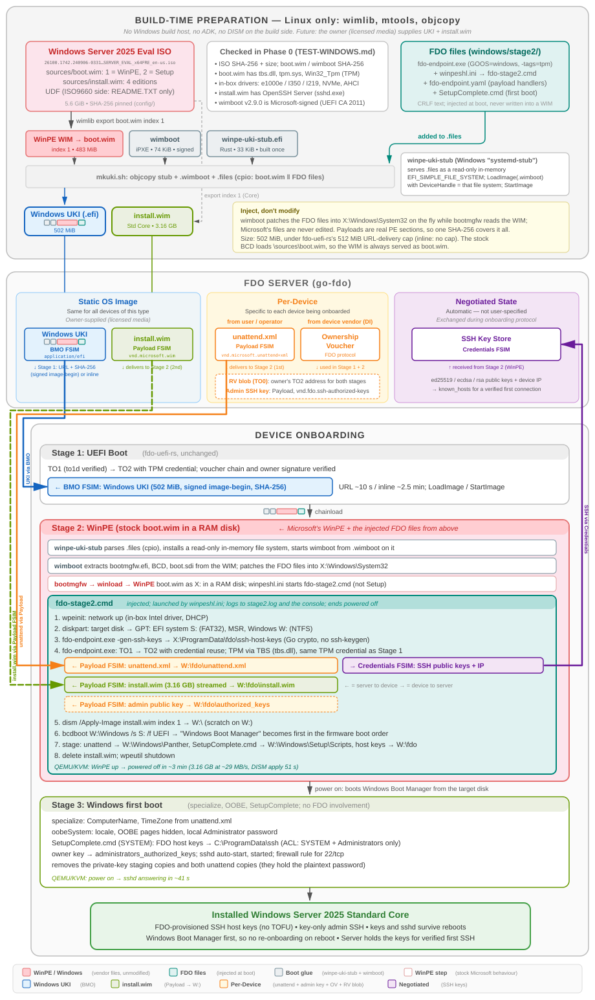

# Windows Server 2025 Installer (FDO "Windows UKI")

[← Overview](README.md) · Test results: [TEST-WINDOWS.md](TEST-WINDOWS.md) · Work tracker: [TODO-WINDOWS.md](TODO-WINDOWS.md)



## Building and Testing

The Windows path boots Microsoft's own **WinPE** (from the Setup `boot.wim` of the Windows Server 2025 evaluation ISO). WinPE runs go-fdo-endpoint, which receives an `unattend.xml` and an `install.wim`, applies the image with DISM and makes the disk bootable. Windows then finishes setup on its own. Everything is built on Linux; there is no Windows build host, no ADK and no DISM on the build side. For the full picture, see the [Windows architecture diagram](doc/fdo-uki-windows-architecture.svg) and [Theory of Operation](#theory-of-operation).

The build is **not scripted yet** (`build-windows-installer.sh` is a TODO). These are the steps the verified runs used, from the repo root:

```bash
source config/windows-installer.env
mkdir -p assets build-windows/iso build-windows/inject3
# 1. Fetch and verify the pinned ISO (5.6 GiB, UDF)
curl -fL -o "assets/$WINDOWS_ISO_NAME" "$WINDOWS_ISO_URL"
echo "$WINDOWS_ISO_SHA256  assets/$WINDOWS_ISO_NAME" | sha256sum -c -
curl -fL -o assets/wimboot-2.9.0 "$WIMBOOT_URL"
echo "$WIMBOOT_SHA256  assets/wimboot-2.9.0" | sha256sum -c -

# 2. Export the two images (no recompression; contents unchanged).
#    `export` APPENDS to an existing WIM, so start from fresh files.
rm -f build-windows/winpe-idx1.wim build-windows/install-core.wim
sudo mount -o loop,ro "assets/$WINDOWS_ISO_NAME" build-windows/iso    # UDF: xorriso cannot read it
wimlib-imagex export build-windows/iso/sources/boot.wim    1 build-windows/winpe-idx1.wim --boot
wimlib-imagex export build-windows/iso/sources/install.wim 1 build-windows/install-core.wim  # Standard Core
sudo umount build-windows/iso

# 3. The agent (go-fdo-endpoint, Windows, TPM via TBS)
(cd ../go-fdo-endpoint && GOOS=windows GOARCH=amd64 go build -tags=tpm -trimpath -ldflags "-s -w" \
    -o ../fdo-uki-build/build-windows/inject3/fdo-endpoint.exe .)

# 4. The stub (once) and the Windows UKI
(cd ../winpe-uki-stub && make release)
for f in winpeshl.ini fdo-stage2.cmd fdo-endpoint.yaml SetupComplete.cmd; do
    sed 's/\r*$/\r/' windows/stage2/$f > build-windows/inject3/$f      # CRLF for cmd.exe
done
ln -sf ../winpe-idx1.wim build-windows/inject3/winpe.wim
../winpe-uki-stub/tools/mkuki.sh -s ../winpe-uki-stub/target/x86_64-unknown-uefi/release/winpe-uki-stub.efi \
    -w assets/wimboot-2.9.0 -o build-windows/winpe-stage3-uki.efi build-windows/inject3/*
sed 's/\r*$/\r/' windows/stage2/unattend.xml > build-windows/unattend.xml
```

Outputs: `build-windows/winpe-stage3-uki.efi` (the Windows UKI, ~502 MiB), `build-windows/install-core.wim` (3.16 GB) and `build-windows/unattend.xml`. Extra host tools: `wimtools` (wimlib), `mtools`, `cpio` (GNU, for `--reproducible`), Rust nightly (for the stub), Go 1.25.

On the test host (needs `qemu-system-x86_64` with KVM, OVMF, `swtpm`, the FDO server `server-installer`, `quick-di-tpm` and the UEFI client disk `efi-disk-release.img`), with the UKI, the image and the unattend copied over:

```bash
P=<dir with unattend.xml and install-core.wim>
INSTALLED_BOOT=1 TARGET_GB=60 TIMEOUT_QEMU=1800 RUN_TAG=phase3 \
SERVER_EXTRA="-payload application/vnd.microsoft.unattend+xml:$P/unattend.xml \
  -payload application/vnd.microsoft.wim:$P/install-core.wim \
  -request-pubkey device_info:device_info" \
windows/spike/start17-winpe-uki.sh winpe-stage3-uki.efi

# Boot the installed disk again later, re-check SSH, optionally leave it running
windows/spike/boot-installed-windows.sh <archived run dir> [--reboot-test] [--keep]
```

The harness does DI with a software TPM, starts the owner and registers TO0, then runs the device VM through Stage 1 and Stage 2. With `INSTALLED_BOOT=1` it also boots the installed disk on its own and logs in over SSH with `StrictHostKeyChecking=yes` against **only** the host keys the owner received over fdo.credentials, plus a wrong-key negative control. It shows each run live (`view.py`: screenshots, milestones, serial log) and archives it. The script header lists all options (`DELIVERY=url|inline`, `BMO_SIGN`, NIC choices, …).

**Verified end to end in QEMU on 2026-10-22:**

- TO1/TO2 in both stages (Stage 2 with credential reuse, TPM via Windows TBS)
- BMO of the 502 MiB Windows UKI, by URL (signed image-begin with SHA-256, ~10 s) and inline (~2.5 min)
- the 3.16 GB `install.wim` streamed to NTFS (~29 MB/s), DISM apply (51 s), bcdboot
- first boot: specialize/OOBE from the unattend, `SetupComplete.cmd`, sshd up ~41 s after power-on; bare machine to SSH in ~5 minutes
- SSH host keys identical to the FDO-registered keys, strict host-key checking with no TOFU; a wrong key is refused
- later boots (cold and in-OS reboot) keep sshd and the keys; with the FDO client disk still attached, the firmware boots Windows Boot Manager

See `TEST-WINDOWS.md` for hashes, timings and every failure found along the way, and `TODO-WINDOWS.md` for remaining work.

## Theory of Operation

The FDO side is the same as for the Linux targets: TO1/TO2 in both stages, BMO, Payload FSIM, Credentials FSIM, credential reuse, and a TO0-registered rendezvous blob. Everything around the installer is different, because Windows is not a kernel plus an initrd.

### At a Glance

- **Build time:** export WinPE (`boot.wim` index 1) and one edition (`install.wim` index 1, Standard Core) from the ISO with wimlib, leaving Microsoft's files untouched. Pack WinPE, wimboot and the FDO files (agent, scripts, config) into **one EFI binary** with `winpe-uki-stub`: the "Windows UKI", 502 MiB.
- **Server:** Windows UKI (BMO), `install.wim` (Payload, `application/vnd.microsoft.wim`), **`unattend.xml`** (Payload, `application/vnd.microsoft.unattend+xml`, sent first), the admin's SSH public key (Payload), voucher, RV blob.
- **Stage 1 (UEFI):** TO1 → TO2 → BMO → chainload, exactly as for the other targets. fdo-uefi-rs is unchanged.
- **Stage 2 (WinPE):** the stub starts wimboot. wimboot starts Microsoft's boot manager on the WIM and injects the FDO files. `winpeshl.ini` runs `fdo-stage2.cmd`, which:
  - partitions the target disk and generates SSH host keys
  - runs TO1 → TO2 and receives the unattend, `install.wim` and admin key onto the new NTFS volume, returning the SSH keys
  - applies the image with DISM, runs bcdboot, stages the unattend and `SetupComplete.cmd`, and powers off
- **Stage 3 (Windows first boot):** specialize and OOBE run from the unattend. `SetupComplete.cmd` installs the FDO host keys for sshd, installs the admin key, starts sshd and removes everything sensitive left from staging.

### Linux targets → Windows mapping

| Concern | Linux targets (Ubuntu, Fedora, openSUSE, ROS 2) | Windows Server 2025 |
| --- | --- | --- |
| Boot artifact | UKI: systemd EFI stub + kernel + initramfs + cmdline | "Windows UKI": `winpe-uki-stub` + wimboot + WinPE WIM + injected files |
| Builder | `objcopy` onto `linuxx64.efi.stub` | `winpe-uki-stub/tools/mkuki.sh` (`objcopy` onto `winpe-uki-stub.efi`) |
| Vendor environment | installer initramfs (casper / dracut) | WinPE (`boot.wim` index 1) in a RAM disk |
| FDO hook | initramfs hook / systemd unit | `winpeshl.ini` → `fdo-stage2.cmd` |
| How FDO files get in | appended cpio / repacked initramfs | wimboot injects them into `X:\Windows\System32` at boot; the WIM is never edited |
| TPM access | `/dev/tpmrm0` | TBS (`tbs.dll`), go-fdo `tpm/open_windows.go` |
| Install media | full vendor ISO streamed into RAM (`/dev/pmem0`) | one exported edition (`install.wim`) streamed onto the target disk |
| Unattended config | autoinstall YAML / kickstart / Agama JSON | `unattend.xml` → `\Windows\Panther` |
| Installer | Subiquity / Anaconda / Agama | `dism /Apply-Image` + `bcdboot`, then Windows first-boot setup |
| SSH key install | late-commands / `%post` / post scripts | `SetupComplete.cmd` (+ `icacls`) |
| Admin access | user's `authorized_keys` from the config | `administrators_authorized_keys`, delivered as a Payload |
| Sizes / QEMU RAM | UKI 106–290 MB, ISO 2.7–4.2 GiB / 8–16 GiB | UKI 502 MiB, image 3.16 GB / 4 GiB |

### Why WinPE, wimboot and a stub

Stage 1 can only chainload one EFI binary, and Windows has no "kernel plus initrd" form. Its network-boot form is the boot manager (`bootmgfw.efi`) loading a WIM into a RAM disk, normally from PXE or a DVD.

- **wimboot** (iPXE project, Microsoft-signed) provides exactly that from memory: it reads its input files from the file system it was loaded from, extracts `bootmgfw.efi`, `BCD` and `boot.sdi` from the WIM itself, and patches extra files into `X:\Windows\System32` as the boot manager reads the WIM.
- **winpe-uki-stub** (separate repo, `../winpe-uki-stub`) is what makes it one file. It carries wimboot and a cpio of files in its own PE sections, serves the cpio as a read-only in-memory `EFI_SIMPLE_FILE_SYSTEM_PROTOCOL`, and starts wimboot on it. It's the Windows counterpart of systemd-stub: built once, with the payload added per OS release.

Because the payloads are real PE sections, the BMO hash covers the boot manager, the WIM and every injected file.

**WinPE rather than Setup:** the Setup `boot.wim` has two images, and Setup (index 2) would start `setup.exe`. Exporting index 1 gives plain WinPE, which still has DISM, diskpart, bcdboot and the TPM stack (WinPE-SecureStartup: `tbs.dll`, `tpm.sys`, `Win32_Tpm`). It is also ~30 MiB smaller, which matters because of the size limit below. The injected `winpeshl.ini` replaces the default shell, so `fdo-stage2.cmd` is the only thing that runs.

**Disk, not RAM, for the install image:** the Linux targets put the whole ISO in RAM and let the stock installer find it there. WinPE's RAM drive is small, and Windows doesn't need its ISO, only an image to apply. So Stage 2 creates the final partition layout first and streams `install.wim` onto the Windows partition. It then applies it in place and deletes it.

### Stage 2: `fdo-stage2.cmd`

1. `wpeinit` (network via WinPE's in-box Intel drivers: e1000e, I350, I219).
2. Find the target disk (`diskpart list disk`; the harness uses a 60 GB disk). `clean`, GPT: EFI system partition `S:` (FAT32, 260 MB), MSR, Windows `W:` (NTFS).
3. `fdo-endpoint.exe -gen-ssh-keys %ProgramData%\fdo\ssh-host-keys` (Go crypto; WinPE has no ssh-keygen).
4. `fdo-endpoint.exe -config fdo-endpoint.yaml`: TO1 → TO2 with credential reuse. The owner address comes from the TPM credential's RV info and the TO0 blob, as on Linux. The payload handlers (`windows/stage2/fdo-endpoint.yaml`) stream each payload to its destination on `W:`, and the Payload FSIM checks the owner's hash. Handler commands run through `cmd.exe /S /C`.
5. `dism /Apply-Image /Index:1 /ApplyDir:W:\` (scratch on `W:`), then `bcdboot W:\Windows /s S: /f UEFI`. bcdboot also puts "Windows Boot Manager" first in the firmware boot order, so the next power-on boots Windows, not Stage 1.
6. Stage `unattend.xml` → `W:\Windows\Panther`, `SetupComplete.cmd` → `W:\Windows\Setup\Scripts`, host keys and agent → `W:\fdo`; delete `install.wim`; `wpeutil shutdown`.

Everything goes to `stage2.log` (on the harness's results disk) and to the screen.

### Unattend and SetupComplete

`windows/stage2/unattend.xml` (test values) sets the computer name and time zone in **specialize**, and locale, hidden OOBE pages and the local Administrator password in **oobeSystem**. It is a per-device Payload, like the Linux configs. On Windows, `SetupComplete.cmd` runs once as SYSTEM at the end of first-boot setup. It:

- copies the FDO host keys to `C:\ProgramData\ssh` and restricts the private keys to SYSTEM and Administrators (Windows sshd refuses broader ACLs)
- installs the owner-delivered key as `administrators_authorized_keys` (same ACL)
- sets sshd to auto-start, starts it, and opens 22/tcp
- **deletes** the private-key staging copies in `C:\fdo` (they inherit `C:\`'s ACL, which lets local users read them) and both unattend copies (they hold the plaintext password); the first Phase 3 run left both behind
- writes the marker `C:\fdo-installed.txt`

OpenSSH Server is part of Windows Server 2025, including Core, but is not enabled by default.

### SSH host keys without TOFU

Same model as the Linux targets ([doc/SSH-HOST-KEYS.md](doc/SSH-HOST-KEYS.md)): the keys are generated in Stage 2, before the OS exists. Their public halves travel to the owner inside the authenticated TO2 session (`fdo.credentials`, `device_info` JSON with ed25519 / ecdsa / rsa keys and the IP), and the installed system uses exactly those keys. The harness builds its `known_hosts` from the owner log only and connects with `StrictHostKeyChecking=yes`. A `known_hosts` with a different key is refused (`REMOTE HOST IDENTIFICATION HAS CHANGED`).

### Runtime Flow (Windows)

Timings are from the verified QEMU run (KVM, 4 vCPU, 4 GiB).

1. **Stage 1:** TO1 (to1d verified) → TO2 → signed BMO image-begin with URL + SHA-256 → download and hash check of the 502 MiB UKI (~10 s) → chainload.
2. **Boot chain:** winpe-uki-stub → wimboot → `bootmgfw.efi` → WinPE (seconds).
3. **Stage 2:**
   - disk layout, SSH keys
   - TO1 → TO2: unattend, `install.wim` (3.16 GB in 1 min 47 s), admin key; SSH keys returned
   - DISM apply (51 s), bcdboot, staging; power off (~4 min since power-on)
4. **Stage 3:** power on → Windows Boot Manager → specialize, OOBE, `SetupComplete.cmd` → sshd answering (~41 s).
5. **Result:** `fdo-win-test`, Windows Server 2025 Standard Core (10.0.26100.1742). It has the FDO-registered SSH host keys and key-only admin SSH, and keeps both across reboots.

### Windows-specific gotchas

- **Size cap:** fdo-uefi-rs aborts HTTP (URL / meta-URL) downloads above 512 MiB. The UKI from the full Setup `boot.wim` is 519.6 MiB and does not fit, hence WinPE only (488 MiB); with the agent it is 502 MiB. Inline delivery has no cap. See [TODO.md](TODO.md) "Stage 1 image size limits".
- **The WIM must be named `boot.wim`:** the stock BCD loads `\sources\boot.wim`; any other name fails with `0xc000000f`. `mkuki.sh` enforces it.
- **The ISO is UDF:** its ISO9660 side holds only `README.TXT`, so `xorriso` can't extract from it. Loop-mount it like the other builders.
- **CRLF:** scripts and config injected into WinPE need CRLF line endings.
- **QEMU test setup:**
  - No `bootindex`: with an explicit boot order OVMF connects only the listed devices, so the UEFI client sees no NIC.
  - The WinPE NIC (e1000e) gets `romfile=`: with QEMU's iPXE ROM, OVMF drives it too, the client runs TO2 over it, and inline rounds become ~40× slower.
  - The firmware stage uses virtio-net, which WinPE has no driver for.
  - Keep the owner database on tmpfs: it fsyncs ~20 times per message.
- **Windows assigns no drive letter to an EFI system partition:** the harness's results volume is a "basic data" partition.
- **Licensing:** unlike the Linux ISOs, Windows media can't be redistributed, so the "vendor ships the UKI" story doesn't carry over. The owner supplies licensed media (evaluation media for development).
- **Secure Boot:** wimboot and `bootmgfw.efi` are Microsoft-signed; winpe-uki-stub and fdo-uefi-rs are not.

## Files

- `config/windows-installer.env`: pinned ISO (URL, size, SHA-256, UDF label), `boot.wim` hash, wimboot URL and hash
- `windows/stage2/`: what goes into the Windows UKI and onto the installed system:
  - `winpeshl.ini`: runs `fdo-stage2.cmd` instead of the WinPE shell / Setup
  - `fdo-stage2.cmd`: Stage 2 (network, disk layout, SSH keys, endpoint, DISM, bcdboot, staging)
  - `fdo-endpoint.yaml`: endpoint config (payload destinations on `W:`)
  - `SetupComplete.cmd`: first-boot SSH setup and cleanup
  - `unattend.xml`: test unattend (hostname, locale, OOBE, test password)
  - `unattend-test.xml`: Phase 2 delivery-only test payload
- `windows/spike/`:
  - `start17-winpe-uki.sh`: end-to-end test harness (DI, owner, TO0, QEMU, payloads, installed-system boot and SSH checks, run archive)
  - `view.py`: live / after-the-fact run viewer (screenshots, milestones, serial log, WinPE logs)
  - `boot-installed-windows.sh`: boot an archived installed disk, re-check SSH, `--reboot-test`, `--keep`
  - `make-spike-disk.sh`, `run-spike-pe2.sh`, `fdo-spike.cmd`, `winpeshl.ini`: Phase 0/1 spikes (WinPE via wimboot from a FAT disk or a Windows UKI, TPM probe)
- `windows/tbs-probe/`: read-only TPM credential probe (go-fdo `tpm` package) for Linux and Windows
- `doc/fdo-uki-windows-architecture.svg`: architecture diagram (Windows)
- `TEST-WINDOWS.md`: discovery findings, all runs, hashes and timings
- `TODO-WINDOWS.md`: Windows phased work tracker
- Related repos: `../winpe-uki-stub` (the stub and `mkuki.sh`); `../go-fdo-endpoint` (Windows port: `shell_windows.go`, `run_dir.go`); `../go-fdo` (`tpm/open_windows.go`)
